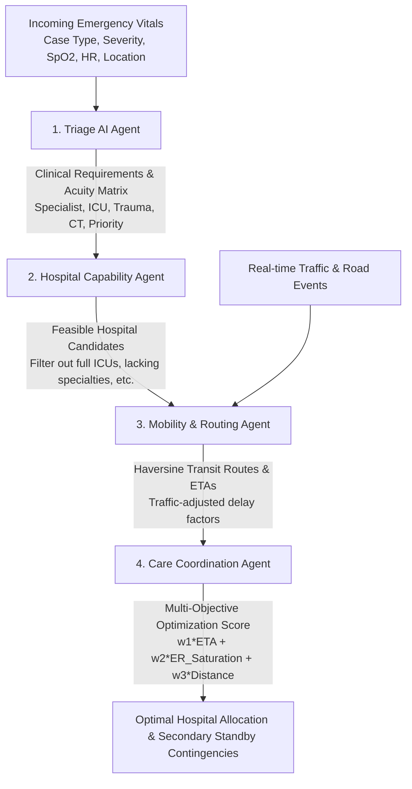

# InTime: Multi-Agent Emergency Medical Dispatch & Ambulance Coordination System

[](https://fastapi.tiangolo.com)
[](https://react.dev)
[](https://www.typescriptlang.org)
[](https://tailwindcss.com)

**InTime** is an intelligent, multi-agent Computer-Aided Dispatch (CAD) and care coordination platform designed to optimize emergency ambulance routing and hospital allocation across metropolitan regions. 

By replacing rigid single-factor routing (which only checks straight-line proximity) with a **cooperative swarm of four specialized autonomous agents**, InTime guarantees that critical patients reach facilities equipped with the **exact clinical specialists, equipment (CT scan, Cath Lab, Trauma Center), and available ICU beds** they need—while dynamically avoiding traffic bottlenecks and overcrowded emergency departments.

---

## Architecture Overview

InTime operates as a synchronized pipeline of four autonomous agents:



### The 4 Specialized Agents

| Agent | Responsibility | Core Intelligence |
| :--- | :--- | :--- |
| **1. Triage AI Agent** | Analyzes patient vitals and extracts clinical requirements. | **Clinical Protocol Inference Engine**: Derives triage priority (`P1-CRITICAL` to `P4`), mandatory specialists, ICU readiness, CT scan requirements, and respiratory urgency from raw physiological telemetry. |
| **2. Hospital Capability Agent** | Evaluates all regional hospitals against extracted requirements. | **Constraint Satisfaction Engine**: Filters hospitals across clinical dimensions: ICU bed availability, certified Level 1/2 Trauma accreditation, 24/7 CT scan capability, specialist availability, and ER saturation ($>95\%$ critical lockout). |
| **3. Mobility & Routing Agent** | Calculates real road distances and traffic-adjusted travel times. | **Dynamic Geographic Routing**: Uses Haversine calculations combined with urban road winding factors ($1.35\times$) and live traffic disruption multipliers ($+140\%$ blockage bypass delays). |
| **4. Care Coordination Agent** | Resolves competing objectives and makes the final dispatch decision. | **Multi-Objective Loss Minimization**: Computes an optimal cost score balancing transit ETA, hospital ER overcrowding, and transit distance. Maintains ranked standby failover routes. |

---

## Key Features

* **Tactical Emergency Operations Center (CAD Dashboard)**:
  * Sleek, high-contrast dark command center interface built for emergency dispatch operators.
  * Real-time telemetry monitoring, mission clocks, and system heartbeat indicators.
* **Interactive Coimbatore EMS Dispatch Radar**:
  * Visualizes the patient pickup point, all 50 regional healthcare facilities, and concentric range rings (5 km, 10 km, 15 km).
  * Dynamic vector trajectory showing the active ambulance transit path to the destination.
  * Interactive facility inspection on radar click (live ICU free beds, ER occupancy %).
* **Pre-Configured Emergency Protocols**:
  * One-click tactical scenario injection:
    * `POL-01`: Highway Polytrauma (Road Traffic Collision)
    * `CRD-02`: STEMI / Acute Cardiac Arrest (Cath Lab Pathway)
    * `STR-03`: Acute Ischemic Stroke (Golden Hour CT / Neuro-ICU)
    * `BRN-04`: Severe Burn Crisis (High TBSA Unit)
    * `ORT-05`: Compound / Unstable Bone Fracture
    * `URO-06`: Acute Renal / Urological Emergency
    * `OPH-07`: Ocular Trauma / Chemical Injury
* **Geographic Coverage across Coimbatore**:
  * Selectable pickup zones with accurate GPS coordinates: Gandhipuram, Peelamedu, RS Puram, Saravanampatti, Singanallur, Thudiyalur, Sundarapuram, Ukkadam, Neelambur, and Saibaba Colony.
* **Dynamic Disruption Simulation & Replanning**:
  * **Simulate ICU Full**: Locks out ICU beds at the winning hospital, forcing instant swarm replanning to secondary facilities.
  * **Simulate Road Block**: Injects corridor blockage with $+140\%$ bypass delay, testing dynamic re-routing.
  * **Reset Mission**: Instantly clears incident logs and restores baseline hospital capacity.

---

## Project Structure

```text
InTime/
├── backend/
│   ├── agents/
│   │   ├── triage_agent.py          # Clinical rules & acuity inference
│   │   ├── hospital_agent.py        # Constraint satisfaction & resource filtering
│   │   ├── mobility_agent.py        # Geographic Haversine distance & routing
│   │   └── coordination_agent.py    # Multi-objective optimization & failover
│   ├── data/
│   │   ├── hospitals.csv            # 50 Coimbatore hospitals with GPS & specialties
│   │   ├── hospital_status.csv      # Real-time ICU availability & ER occupancy
│   │   ├── events.csv               # Active traffic & capacity incident log
│   │   └── patients.csv             # Active patient emergency profile
│   ├── main.py                      # FastAPI server & multi-agent pipeline orchestration
│   ├── requirements.txt             # Python dependencies
│   └── migrate_data.py              # Data synchronization utility
├── frontend/
│   ├── src/
│   │   ├── App.tsx                  # Tactical CAD Operations Dashboard
│   │   ├── main.tsx                 # React DOM entrypoint
│   │   └── index.css                # Custom HUD styling & radar grid
│   ├── package.json                 # Node dependencies (React 18, Vite, Lucide)
│   ├── tailwind.config.js           # Tailwind CSS configuration
│   └── vite.config.ts               # Vite bundler configuration
├── Data/                            # Raw dataset benchmarks & reference lists
├── start_intime.command             # One-click startup script for macOS
├── .gitignore                       # Git ignore configuration
└── README.md                        # Documentation
```

---

## Quickstart & Installation

### Prerequisites

Ensure you have the following installed on your machine:
* **Python 3.10+**: `python3 --version`
* **Node.js 18+** and **npm**: `node --version && npm --version`
* **Git**: `git --version`

---

### Step 1: Clone the Repository

```bash
git clone https://github.com/Shravanthi20/InTime.git
cd InTime
```

---

### Step 2: Set Up the Backend

1. Navigate to the `backend/` directory:
   ```bash
   cd backend
   ```

2. Create and activate a Python virtual environment:
   ```bash
   # On macOS / Linux:
   python3 -m venv venv
   source venv/bin/activate

   # On Windows:
   python -m venv venv
   venv\Scripts\activate
   ```

3. Install required Python packages:
   ```bash
   pip install -r requirements.txt
   ```

---

### Step 3: Set Up the Frontend

1. In a new terminal window, navigate to the `frontend/` directory:
   ```bash
   cd frontend
   ```

2. Install dependencies:
   ```bash
   npm install
   ```

---

### Step 4: Run the Application

You can launch both the backend and frontend simultaneously or individually.

#### Option A: Quick Launch (macOS)
Make the launch script executable and run it:
```bash
chmod +x start_intime.command
./start_intime.command
```

#### Option B: Manual Launch (Two Terminals)

* **Terminal 1: Backend Server**
  ```bash
  cd backend
  source venv/bin/activate
  uvicorn main:app --host 0.0.0.0 --port 8000 --reload
  ```
  *Backend API will be running at [http://localhost:8000](http://localhost:8000)*
  *Interactive Swagger API documentation: [http://localhost:8000/docs](http://localhost:8000/docs)*

* **Terminal 2: Frontend Dashboard**
  ```bash
  cd frontend
  npm run dev
  ```
  *Frontend UI will be running at [http://localhost:5173](http://localhost:5173)*

---

## Verifying Model Behavior (Live Test Guide)

Once the application is running at `http://localhost:5173`, test these scenarios to observe how the multi-agent system adapts:

1. **Test Stroke Protocol**:
   * Click preset `STR-03 (Stroke Protocol)` or enter a patient with **Acute Ischemic Stroke** at **Peelamedu**.
   * **Result**: Filters out non-neurology centers (e.g. Sree Siva, Nehru Urology). Routes to **PSG Hospitals** or **KMCH** (closest certified Neuro-ICU centers with 24/7 CT scan).
2. **Test Severe Burn Crisis**:
   * Click preset `BRN-04 (Severe Burn)` at **Saibaba Colony**.
   * **Result**: Filters out general hospitals lacking sterile burn units. Selects **Ganga Medical Centre & Hospitals** (~1.1 km away).
3. **Test Cardiac STEMI**:
   * Click preset `CRD-02 (STEMI / Cardiac)` at **RS Puram**.
   * **Result**: Allocates to dedicated cardiac centers such as **KG Hospital** or **CMCH**.
4. **Test Dynamic Replanning (Hospital Full)**:
   * Observe the winning hospital, then click **Simulate ICU Full**.
   * **Result**: Live event triggers, ICU availability drops to 0, Hospital Capability Agent disqualifies the hospital, and Care Coordination Agent automatically re-allocates to the next best standby facility.
5. **Test Traffic Rerouting (Road Block)**:
   * Click **Simulate Road Block**.
   * **Result**: Transit corridor delay multiplier activates ($+140\%$), and Mobility Agent re-routes around the obstruction.

---

## Technology Stack

* **Frontend**: React 18, TypeScript, Vite, Tailwind CSS, Lucide Icons
* **Backend**: FastAPI, Uvicorn, Pydantic, Python 3
* **Routing Algorithms**: Haversine Spherical Distance, Urban Tortuosity Modeling, Dynamic Delay Penalty Matrix
* **Optimization Function**: Multi-Objective Weighted Cost Score ($\min \sum w_i \cdot x_i$)

