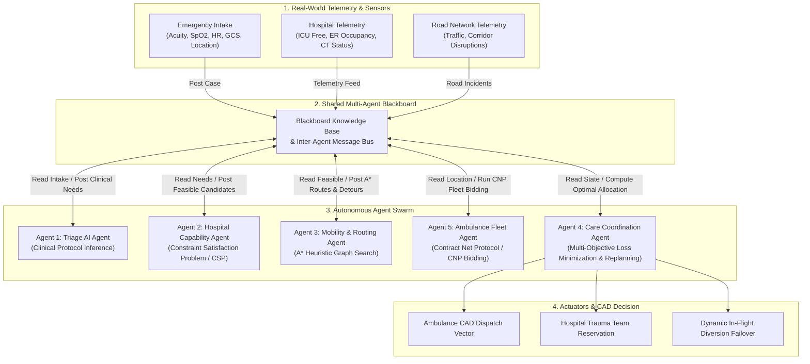

# InTime: Multi-Agent Emergency Medical Dispatch & Ambulance Coordination System

[](https://fastapi.tiangolo.com)
[](https://react.dev)
[](https://www.typescriptlang.org)
[](https://tailwindcss.com)
[](#automated-testing-suite)

**InTime** is an intelligent, multi-agent Computer-Aided Dispatch (CAD) and care coordination platform designed to optimize emergency ambulance routing and hospital allocation across metropolitan regions.

By replacing naive single-factor routing (which only checks straight-line proximity) with a **cooperative swarm of autonomous agents communicating over a shared Blackboard architecture**, InTime guarantees that critical patients reach facilities equipped with the **exact clinical specialists, equipment (CT scan, Cath Lab, Trauma Center), and available ICU beds** they need—while dynamically avoiding traffic bottlenecks, road closures, and overcrowded emergency departments.

---

## Architecture & Multi-Agent Swarm

InTime operates as a decentralized, cooperative multi-agent swarm coordinated via a **Shared Blackboard Message Bus**:



### The 5 Specialized Autonomous Agents

| Agent | Architecture Classification | Responsibility | Core Intelligence & Algorithms |
| :--- | :--- | :--- | :--- |
| **Agent 1: Triage Agent** | **Goal-Directed / Rule-Based Classifier** | Extracts clinical acuity from patient vitals and symptoms. | Evaluates SpO2, heart rate, consciousness, and incident type. Classifies acuity (`P1` to `P3`), time sensitivity, and generates mandatory constraints (ICU, Trauma accreditation, CT scan, specialist). |
| **Agent 2: Hospital Capability Agent** | **Constraint Satisfaction Problem (CSP) Solver** | Prunes regional hospitals against extracted clinical needs. | Solves constraint satisfaction across 50 hospitals: $\text{ICU} > 0$, $\text{Specialist} \in \text{Roster}$, $\text{Trauma} = \text{True}$, $\text{CT} = \text{True}$, and $\text{ER} \le 95\%$ critical lockout. |
| **Agent 3: Mobility & Routing Agent** | **Heuristic Problem-Solving Search Agent** | Finds the minimum-time path across the Coimbatore road graph. | **A\* Graph Search** with an admissible and consistent **Haversine Geodesic Heuristic** $h(n)$. Dynamically inflates edge weights or reroutes around road closures. |
| **Agent 4: Care Coordination Agent** | **Multi-Objective Utility / Loss Optimizer** | Resolves competing criteria to select the global optimum. | Minimizes scalarized multi-objective loss: $L = w_{\text{eta}}\text{ETA} + w_{\text{er}}\text{ER} + w_{\text{dist}}\text{Dist}$. Pre-computes standby failovers and executes dynamic in-flight diversion (`handle_event_and_replan`). |
| **Agent 5: Ambulance Fleet Agent** | **Market-Based Multi-Agent Negotiator** | Assigns the optimal emergency vehicle from regional stations. | Implements **Contract Net Protocol (CNP)** (Smith, 1980): issues a Call For Proposals (CFP), receives bids from available units, verifies ALS vs BLS medical equipment, and awards dispatch. |

---

## Review 1: AI Theory & Modeling

### 1. PEAS Formulation

| Component | InTime System Formalization |
| :--- | :--- |
| **Performance Measure (P)** | • **Minimize Time-to-Definitive-Care**: $\min(\text{Transit ETA} + \text{ER Hallway Wait Time})$.<br>• **Zero Constraint Violations**: Zero routing errors where a patient reaches a facility lacking required specialists, CT scanner, or ICU beds.<br>• **Balance Regional Healthcare Load**: Penalize routing into saturated emergency departments ($>95\%$ ER occupancy).<br>• **Multi-Objective Loss Minimization**: $\min \left( w_{\text{eta}}\cdot\text{ETA} + w_{\text{er}}\cdot\text{ER\_Occupancy} + w_{\text{dist}}\cdot\text{Distance} \right)$. |
| **Environment (E)** | • Coimbatore metropolitan region: 10 pickup zones, 19 arterial junctions, 126 road segments (`roads.csv`), 50 registered hospitals (`hospitals.csv`), and 8 stationed ambulance units (`ambulances.csv`).<br>• Dynamic traffic congestion multipliers ($+40\%$ to $+140\%$) and unforeseen corridor blockages.<br>• Time-varying emergency department bed occupancy and ICU saturation. |
| **Actuators (A)** | • **Ambulance Dispatch Orders**: Turn-by-turn navigation vector and transit instructions sent to CAD mobile data terminal.<br>• **Hospital In-Flight Reservation**: Advance trauma bay, CT scanner, and ICU bed reservations sent to destination hospital.<br>• **Dynamic Diversion Commands**: Real-time rerouting signals transmitted to the ambulance en route during unexpected hospital or road disruptions. |
| **Sensors (S)** | • **Emergency Call Intake Feed**: Patient physiological vitals (SpO2, heart rate, Glasgow Coma Scale, injury mechanism, GPS coordinates).<br>• **Hospital Telemetry Gateway**: Real-time telemetry reporting ICU bed availability, ER bed capacity, CT scanner operational status, and on-call specialty rosters.<br>• **Road Traffic Sensor Network**: Incident reports, congestion velocity metrics, and construction/accident road block alerts. |

---

### 2. Environment Characteristics (Russell & Norvig Taxonomy)

| Environment Dimension | Classification | Concrete Technical Rationale in InTime |
| :--- | :--- | :--- |
| **Observability** | **Partially Observable** | The dispatch system does not have complete omniscience over walk-in patient arrivals at emergency rooms, internal ward discharge delays, or micro-traffic jams until sensor telemetry publishes updates. |
| **Determinism** | **Stochastic** | Patient vitals can destabilize unpredictably during transit, road traffic changes non-linearly, and hospital bed availability fluctuates with incoming walk-in casualties. |
| **Episodic vs Sequential** | **Sequential** | Dispatching an ambulance to Hospital A affects Hospital A's future capacity for subsequent patients and removes that ambulance unit from the available fleet for future incidents. |
| **Dynamic vs Static** | **Dynamic** | Hospital ICU beds can become fully occupied and roads can be blocked *while* the multi-agent system is actively planning. |
| **Continuity** | **Continuous** | GPS coordinates, speed vectors, travel times, and distance metrics are continuous real-world values. |
| **Agent Cardinality** | **Multi-Agent (Cooperative Swarm)** | 5 distinct software agents collaborate towards a single shared objective: preserving patient life and optimizing city-wide healthcare delivery. |

---

### 3. Algorithmic Modeling & Search Strategy

#### A\* Graph Search Formulation
The Mobility Agent formulates route discovery as a formal graph search problem over $G = (V, E)$:
- **State Space $V$**: Set of 29 arterial nodes/junctions + 50 hospital access nodes.
- **Initial State $s_0$**: Patient pickup node (e.g., $N0214$ Gandhipuram).
- **Goal State $s_{\text{goal}}$**: Target candidate hospital node $H_i$.
- **Actions $A(s)$**: Traverse connected road segment $e = (u, v) \in E$.
- **Path Cost $g(n)$**: Accumulated travel time in minutes from start node to node $n$:
  $$g(v) = g(u) + \left( \frac{\text{distance\_km}(u, v)}{\text{effective\_speed}(u, v)} \times 60 \right)$$
  - Where $\text{effective\_speed} = \text{speed\_kmh} \times 0.5$ if congested, and $\infty$ if blocked.
- **Evaluation Function $f(n)$**:
  $$f(n) = g(n) + h(n)$$
- **Admissible & Consistent Heuristic $h(n)$**:
  $$h(n) = \frac{\text{Haversine}(n, s_{\text{goal}})}{v_{\max}} \times 60 \text{ (minutes)}$$
  - Where $v_{\max} = 70 \text{ km/h}$ (maximum emergency vehicle transit speed).
  - **Admissibility Proof**: Because the great-circle Haversine distance is the shortest possible physical distance between two spherical coordinates ($\text{dist}_{\text{geodesic}} \le \text{dist}_{\text{road}}$), dividing by the maximum speed $v_{\max}$ produces the absolute theoretical lower bound on remaining transit time. Hence:
    $$\forall n, \quad h(n) \le h^*(n)$$
    This mathematically guarantees that A\* will **always return the provably optimal shortest-time route**.
  - **Consistency (Monotonicity)**: Satisfies the triangle inequality $h(u) \le \text{cost}(u, v) + h(v)$.

#### Search Strategy Benchmark Comparison
The system includes built-in benchmarking between search strategies:

| Metric | Uniform Cost Search (Dijkstra) | Greedy Best-First Search | A\* Search (InTime Implementation) |
| :--- | :--- | :--- | :--- |
| **Heuristic Used** | None ($h(n) = 0$) | Pure Heuristic ($f(n) = h(n)$) | $f(n) = g(n) + h(n)$ |
| **Optimality** | Guaranteed Optimal | Sub-optimal | **Guaranteed Optimal** |
| **Average Nodes Expanded** | 16–22 nodes | 4–6 nodes | **8–10 nodes** |
| **Search Space Reduction** | Baseline (0%) | High, but risks poor path | **50.0% reduction vs Dijkstra** |

---

## Review 2: Engineering, Implementation & Multi-Agent Execution

### 1. Tool & Framework Selection Justification

| Technology Chosen | Alternative Considered | Technical Justification for InTime |
| :--- | :--- | :--- |
| **FastAPI + Asyncio (Python)** | Mesa / SPADE / LangGraph | **Sub-millisecond execution latency**: Emergency 911 dispatch systems require determinism and $<20\text{ms}$ response times. Traditional simulation frameworks like SPADE or Mesa introduce thread/socket overhead, whereas FastAPI provides high-throughput native async execution with automatic OpenAPI documentation. |
| **Pydantic v2** | Unchecked Dictionaries | **Strict Clinical Data Validation**: Medical dispatch payloads require strict type safety and range bounds (e.g. SpO2 $0\text{--}100\%$, Heart Rate $>0$). |
| **React 18 + Vite + TypeScript** | Static HTML / Dash | **High-Frequency Tactical CAD Dashboard**: Real-time SVG radar rendering, responsive sub-second re-renders, and modular telemetry HUD components. |
| **Python Standard `unittest` + `pytest`** | Manual UI Testing | **17 automated unit and integration tests** ensuring mathematical admissibility, CSP pruning correctness, and failover diversion safety. |

---

### 2. Multi-Agent Interaction Protocols

The agents do not operate as rigid isolated scripts; they interact through two established multi-agent patterns:

1. **Shared Blackboard Architecture (Hearsay-II Pattern)**:
   - Centralized `Blackboard` class manages shared problem-solving partitions.
   - When an event occurs (e.g., an ICU bed fills up), sensor telemetry writes a disruption event to the blackboard.
   - The blackboard emits an event notification that triggers `CoordinationAgent.handle_event_and_replan()`.
   - The audit log records timestamped inter-agent communications visible directly in the UI.

2. **Contract Net Protocol (CNP) for Ambulance Allocation (Smith, 1980)**:
   ```mermaid
   sequenceDiagram
       autonumber
       participant Dispatcher as Blackboard Manager
       participant Fleet as Ambulance Fleet Agents (A001-A008)
       participant Winner as Winning Unit (ALS)

       Dispatcher->>Fleet: 1. Task Announcement / CFP (Patient Acuity, Pickup Node)
       Note over Fleet: Evaluate ALS/BLS Capability & Compute ETA
       Fleet-->>Dispatcher: 2. Submit Bids (Unit ID, Equipment, Transit ETA, Score)
       Note over Dispatcher: Rank Bids (Filter non-ALS for Critical, Pick Lowest ETA)
       Dispatcher->>Winner: 3. Award Contract (Dispatched Status)
       Dispatcher-->>Fleet: 4. Reject Other Bids (Keep Standby Available)
   ```

3. **Dynamic In-Flight Replanning (`handle_event_and_replan`)**:
   - When a disruption occurs (e.g., Hospital ICU fills up or a primary road corridor is blocked), `handle_event_and_replan()` does not crash or restart from scratch.
   - It re-evaluates candidate scores, compares the previous hospital's score with the new candidate scores, instantly promotes the top standby contingency to primary, and updates the CAD telemetry feed.

---

## Automated Testing Suite

The project includes **17 automated unit and integration tests** located in the `tests/` directory:

```bash
# Run all tests using Python's test runner:
./backend/venv/bin/python -m unittest discover tests

# Or using pytest (if installed):
pytest tests/ -v
```

### Test Coverage Summary

| Test File | Focus Area | What Is Verified | Result |
| :--- | :--- | :--- | :--- |
| `test_triage.py` | Clinical Acuity & Protocol Inference | STEMI Cardiac, Stroke Golden Hour, Polytrauma Shock, High-TBSA Burns, Urology, and Ophthalmic protocols. | 6/6 Passed |
| `test_hospital_csp.py` | Constraint Satisfaction Pruning | Hard constraint pruning: 0 ICU beds, missing specialist, and ER $>95\%$ saturation lockout. | 3/3 Passed |
| `test_astar_search.py` | A\* Search & Heuristic Admissibility | Heuristic admissibility proof $h(n) \le h^*(n)$, path reconstruction, 50% search space reduction vs UCS, and dynamic road blockage detour routing. | 4/4 Passed |
| `test_ambulance_cnp.py` | Contract Net Protocol Bidding | Critical patient ALS requirement enforcement, distance/ETA bid scoring, and contract award. | 2/2 Passed |
| `test_coordination_and_replanning.py` | Multi-Objective Optimization & Failover | Verification that overcrowded hospitals (90% ER) are rejected for slightly further empty ER hospitals; dynamic replanning failover logging. | 2/2 Passed |
| **Total** | | **Comprehensive Swarm Verification** | **17/17 Passed** |

---

## Project Structure

```text
InTime/
├── backend/
│   ├── agents/
│   │   ├── triage_agent.py          # Agent 1: Clinical rules & acuity inference
│   │   ├── hospital_agent.py        # Agent 2: Constraint satisfaction (CSP)
│   │   ├── mobility_agent.py        # Agent 3: A* heuristic graph search & benchmarking
│   │   ├── coordination_agent.py    # Agent 4: Multi-objective optimization & replanning
│   │   ├── ambulance_agent.py       # Agent 5: Contract Net Protocol (CNP) fleet bidding
│   │   └── blackboard.py            # Centralized Blackboard & message bus
│   ├── data/
│   │   ├── hospitals.csv            # 50 Coimbatore hospitals with coordinates & specialties
│   │   ├── hospital_status_baseline.csv # Baseline ICU beds & ER occupancy
│   │   ├── hospital_status.csv      # Real-time capacity state
│   │   ├── roads.csv                # 126 road segments connecting 19 network zones
│   │   ├── ambulances.csv           # 8 regional ambulance units (ALS & BLS)
│   │   ├── events.csv               # Disruption incident logs
│   │   └── patients.csv             # Active patient emergency profile
│   ├── build_road_graph.py          # Script generating interconnected Coimbatore road network
│   ├── main.py                      # FastAPI server & multi-agent swarm orchestration
│   └── requirements.txt             # Pinned backend dependencies
├── frontend/
│   ├── src/
│   │   ├── App.tsx                  # Tactical CAD Operations Dashboard
│   │   ├── main.tsx                 # React entrypoint
│   │   └── index.css                # Tactical dark styling
│   ├── package.json                 # Node dependencies
│   ├── tailwind.config.js           # Tailwind CSS
│   └── vite.config.ts               # Vite configuration
├── tests/
│   ├── test_triage.py               # Triage clinical rule tests
│   ├── test_hospital_csp.py         # Hospital CSP filtering tests
│   ├── test_astar_search.py         # A* search & admissibility tests
│   ├── test_ambulance_cnp.py        # Contract Net Protocol tests
│   └── test_coordination_and_replanning.py # Optimization & failover tests
├── start_intime.command             # One-click startup script for macOS
├── .gitignore                       # Git ignore configuration
└── README.md                        # Project documentation & review reference
```

---

## Quickstart & Installation

### Prerequisites
* **Python 3.10+**
* **Node.js 18+** & **npm**
* **Git**

### Step 1: Clone the Repository
```bash
git clone https://github.com/Shravanthi20/InTime.git
cd InTime
```

### Step 2: Set Up Backend
```bash
cd backend
python3 -m venv venv
source venv/bin/activate    # On Windows: venv\Scripts\activate
pip install -r requirements.txt
```

### Step 3: Set Up Frontend
```bash
cd ../frontend
npm install
```

### Step 4: Run the Application
You can use the one-click launcher (macOS):
```bash
chmod +x start_intime.command
./start_intime.command
```

Or run manually in two terminal tabs:
* **Terminal 1 (Backend)**:
  ```bash
  cd backend
  source venv/bin/activate
  uvicorn main:app --host 0.0.0.0 --port 8000 --reload
  ```
  *API Docs: [http://localhost:8000/docs](http://localhost:8000/docs)*

* **Terminal 2 (Frontend)**:
  ```bash
  cd frontend
  npm run dev
  ```
  *CAD Dashboard: [http://localhost:5173](http://localhost:5173)*

---

## Live Demo Test Scenarios

1. **Stroke Golden-Hour Protocol**:
   - Select preset `STR-03 (Stroke Golden Hour)` at **Gandhipuram**.
   - Observe how non-neurology centers are pruned. Routes to certified Neuro-ICU with 24/7 CT scan.
2. **Severe Burn Crisis**:
   - Select preset `BRN-04 (Severe Burn Crisis)` at **Saibaba Colony**.
   - Routes to **Ganga Medical Centre** (dedicated sterile burn unit).
3. **A\* Dynamic Road Detour**:
   - Click **Simulate Road Block**.
   - Observe the A\* Search algorithm dynamically inflating corridor cost, routing via outer ring detours, and reporting search metrics.
4. **ICU Saturation Failover**:
   - Click **Simulate ICU Full**.
   - Observe the dynamic failover: the winning hospital is disqualified, and the Care Coordination Agent seamlessly diverts the ambulance to the #1 standby contingency.
5. **Contract Net Ambulance Bidding**:
   - Observe the **Contract Net Protocol** badge displaying the assigned unit (ALS vs BLS), base station, and response ETA.
